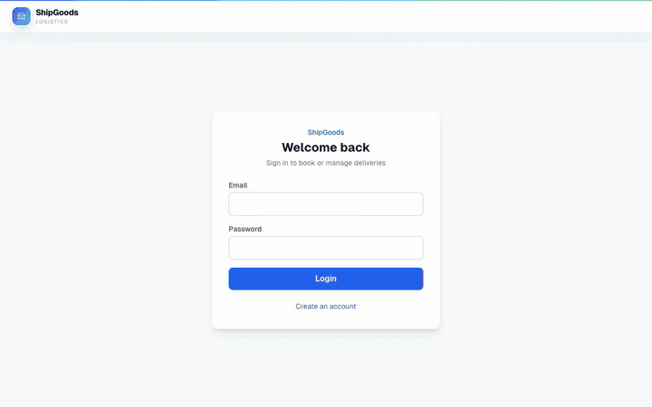
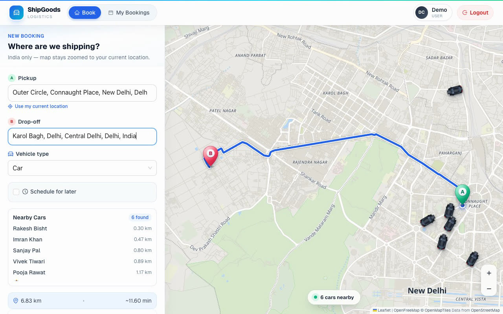
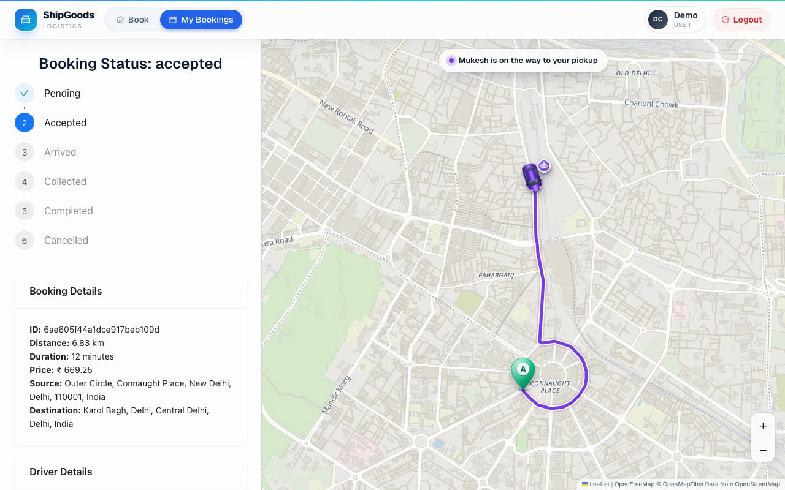
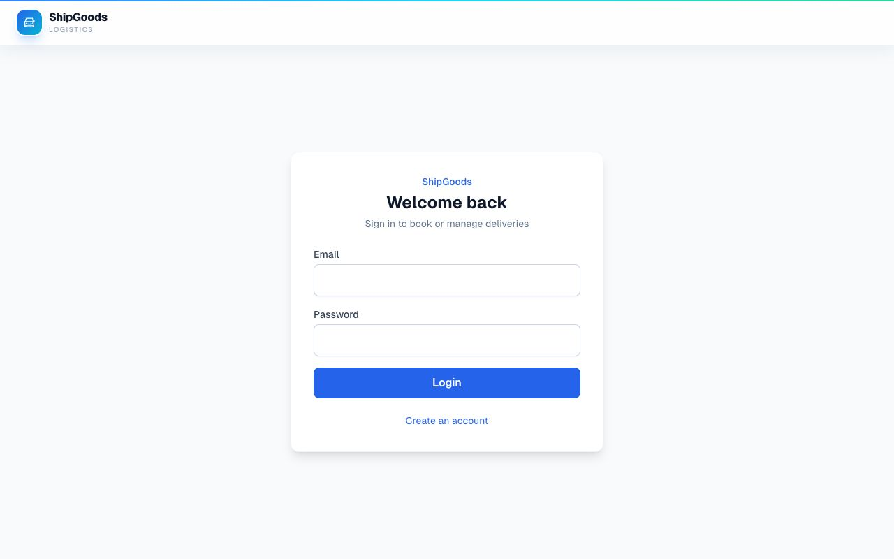

# ShipGoods is a Logistics Platform for Goods Transportation

## Overview
The **On-Demand Logistics Platform** is a scalable system designed to facilitate goods transportation by connecting users with a fleet of drivers. The platform offers real-time booking, tracking, and price estimation services while ensuring efficient handling of high traffic volumes.

## Live Demo

| | Link |
|---|---|
| **Web app (production)** | https://shipgoods-web.onrender.com |
| **API (production)** | https://shipgoods-api.onrender.com ([health](https://shipgoods-api.onrender.com/health)) |

> Both run on Render's free plan, so the first request after a quiet spell can take ~30 seconds while the services wake up.

### Booking → live tracking (screen recording)



Full-quality video: [`docs/demo/shipgoods-live-tracking.mp4`](docs/demo/shipgoods-live-tracking.mp4) (1 min 20 s). Recorded in Chrome on the real app with showcase mode on: the customer logs in at Connaught Place, sees six nearby drivers, picks Karol Bagh as drop-off (road route + fare), taps **Request to Pick**, the per-customer bot driver *Mukesh Yadav* accepts, and the tracking screen follows the car along the real road towards the pickup while the remaining route shrinks behind it.

| Booking map with nearby drivers | Live tracking |
|---|---|
|  |  |

| Production portal |
|---|
|  |

### AI pickup call (real call recording)

🔊 [`docs/demo/ritu-pickup-call.mp3`](docs/demo/ritu-pickup-call.mp3): a real call from the voice agent **Ritu** to a customer whose driver was on the way (31 Oct 2026, 2 min 18 s). Every number in it came from live tools during the call:

| | Speaker | Said |
|---|---|---|
| 0:00 | Ritu | नमस्ते, मैं शिपगुड्स से रितु बात कर रही हूँ। आपके ड्राइवर महेश करीब दस मिनट में पहुँच जाएँगे, गाड़ी नंबर डी एल एक सी, बारह चौंतीस है। |
| 0:28 | Customer | तो अभी गाड़ी कहाँ पे है? |
| 0:32 | Ritu | ड्राइवर अभी काला कैफ़े के पास हैं और आपके पिकअप पॉइंट से सवा किलोमीटर दूर हैं। *(driver_location)* |
| 0:53 | Customer | गाड़ी कौन सी है? |
| 0:56 | Ritu | आपकी बुकिंग के लिए Tata Ace truck आ रहा है। *(booking_details)* |
| 0:59 | Customer | कितना सामान ले जा सकता हूँ, वेट? |
| 1:06 | Ritu | Tata Ace truck में करीब सात सौ पचास किलो तक का सामान ले जा सकते हैं। *(pickup_policy)* |
| 1:42 | Customer | कार कहाँ पे है, डिस्टेंस में? |
| 1:46 | Ritu | ड्राइवर अभी द इम्पीरियल के पास हैं, नौ सौ मीटर दूर, आपकी तरफ ही आ रहे हैं। *(driver_location)* |
| 1:55 | Customer | कितना टाइम लगेगा? |
| 1:57 | Ritu | करीब पाँच मिनट में, रात आठ बजकर पच्चीस मिनट तक पहुँच जाएँगे। *(trip_info, Google live traffic)* |
| 2:08 | Ritu | ठीक है, महेश जी आठ बजकर पच्चीस मिनट तक पहुँच जाएँगे, अपना सामान तैयार रखियेगा। धन्यवाद! *(ends the call)* |
## Key Features

### User Features
- **Booking Service**:  
  Users can book transportation by specifying:
  - Pickup location
  - Drop-off location
  - Type of vehicle (e.g., truck, van)
  - Estimated cost
  
- **Real-Time Tracking**:  
  Track the driver’s location from pickup to drop-off on a Leaflet map with free OpenFreeMap vector tiles (no API key). The car glides between GPS updates and turns with the road, and only the road still ahead of it is drawn.

- **Price Estimation**:  
  Get upfront price estimates based on distance, vehicle type, and demand.

### Driver Features
- **Job Assignment**:  
  Drivers receive booking requests with details of the job. After accepting, they can see:
  - Pickup and drop-off locations
  - Job details
  
- **Job Status Updates**:  
  Drivers can update job progress:
  - En route to pickup
  - Goods collected
  - Goods delivered

### Admin Features
- **Fleet Management**:  
  Manage vehicle availability, monitor driver activity, and track system health.

- **Data Analytics**:  
  Analytics include:
  - Total trips completed
  - Average trip time
  - Driver performance metrics
  
- **Scheduled Bookings**:  
  Users can schedule trips for future dates and times.

### AI Pickup Call (Sarvam Voice Agent)
Shortly before the driver reaches pickup, ShipGoods places **one real phone call** to the customer who booked, in Hindi/Hinglish, through a **Sarvam Voice Agent** ("Ritu"; hear it in the [real call recording](#ai-pickup-call-real-call-recording) above). Its full definition (prompt, voice, settings and tools) is in [`server/sarvam-agent/`](server/sarvam-agent/) so it can be recreated in any Sarvam workspace:

- **When:** ETA to pickup ≤ 6 minutes (Google Routes with live traffic, falling back to OSRM), or ≤ 2 km straight-line if no ETA is available. If the driver accepts while already that close, the call goes out immediately.
- **How often:** once per booking; if the customer doesn't answer, one retry after ~1 minute. No call on arrival (30 m) — the booking is marked "arrived" and the app notifies the rider. Cancelled bookings never get a call.

**How a call works end to end:**
1. `server/src/services/voice/arrivalDetector.js` checks every live driver-location update and, when the rule above is met, creates a `VoiceCall` and asks Sarvam's Instant Outbound API (`services/sarvam/outbound.js`) to dial the customer, passing `callId`, `bookingId`, `driverName`, `vehicleNo` and `etaMinutes` as agent variables.
2. Sarvam runs the whole conversation (telephony, speech-to-text, LLM, text-to-speech). For live data or actions, the agent calls our HTTP tools (`server/src/routes/sarvamTools.js`), each protected by the `X-ShipGoods-Tool-Secret` header and accepted only for a currently active call:
   - `POST /api/voice/tools/trip-info` — ETA and arrival clock time, distance, average speed, traffic and delay, driver first name, vehicle number/type (never the customer's phone)
   - `POST /api/voice/tools/traffic-info` — Google live traffic on the driver's road: level, minutes vs usual, delay, main road, share of the route slow or jammed
   - `POST /api/voice/tools/driver-location` — nearest landmark and other places around the driver, area/road, distance, direction, approaching or stopped
   - `POST /api/voice/tools/booking-details` — pickup/drop, fare, payment, vehicle, schedule, pickup-to-drop time with traffic
   - `POST /api/voice/tools/find-vehicle` — the landmark next to the vehicle when the customer can't spot it
   - `POST /api/voice/tools/pickup-note` — the customer's exact instruction (gate, floor, lift…) sent to the driver's app
   - `POST /api/voice/tools/notify-driver` — `coming_down` | `need_five_minutes` | `need_help` | `call_me` | `urgent`, shown as a toast in the driver app
   - `POST /api/voice/tools/pickup-policy` — answers from `server/knowledge/pickup-faq.md`

   Distances and number plates are returned as ready-to-speak Hindi ("सवा किलोमीटर", "डी एल एक सी, बारह चौंतीस") so the voice sounds natural.
3. When the call ends, Sarvam posts to `POST /api/voice/sarvam-webhook`; the `VoiceCall` is marked completed / missed / failed with duration and transcript, and a missed call gets its one retry.

If Sarvam isn't configured, the customer has no phone number, or Sarvam rejects the request, the call falls back to the **in-app ring**: the existing browser voice agent (`services/voiceAgent/`, Groq + Sarvam text-to-speech) answers inside the rider's ShipGoods tab.

Server environment (`server/.env`): `VOICE_CALLS_ENABLED=true`, `SARVAM_API_KEY`, `SARVAM_ORG_ID`, `SARVAM_WORKSPACE_ID`, `SARVAM_APP_ID`, `SARVAM_APP_VERSION`, `SARVAM_CONNECTION_ID`, `SARVAM_AGENT_PHONE_NUMBER`, `PUBLIC_BASE_URL` (public URL of this server, e.g. an ngrok static domain), `SARVAM_TOOL_SECRET`, optional `VOICE_ALLOWED_NUMBERS` (comma-separated numbers verified in Sarvam; a customer whose account phone is on this list is called on that number) and `VOICE_TEST_NUMBER` (where every other call goes while testing; with the allow-list set and no test number, other customers get the in-app ring instead of a phone call), `GOOGLE_MAPS_API_KEY`, and tuning `PICKUP_CALL_ETA_MINUTES` / `PICKUP_CALL_DISTANCE_METERS` / `PICKUP_CALL_RETRY_AFTER_MS`. `npm run test-call` rings a verified number for a fake booking; on a deployed server, `POST /api/voice/test-call` (header `X-ShipGoods-Tool-Secret`, optional body `{"phone": "+91…"}`) does the same and drives the fake driver towards pickup during the call, so the tools return live ETA.

---

## Architecture

### System Design
1. **Scalability**:  
   The API is stateless, so several instances can run behind a load balancer:
   - **MongoDB**: Primary database for users, drivers, vehicles, bookings and call records. A 2dsphere index on `Driver.currentLocation` powers the nearby-driver search.
   - **Redis**: Live driver positions (TTL'd), driver-to-rider routing, active trips, one-call-per-booking locks, rate limits for routing/ETA lookups and Mongo location writes, and in-app agent chat history.
   - **Kubernetes** (`server/infra/k8s`): 3 replicas, secrets from a Secret, `/health` readiness/liveness probes.
2. **Real-Time Communication**:
   - **Socket.IO** (with a Redis adapter) for live driver tracking, booking updates, and the in-app voice-call fallback signaling — JWT-authenticated per socket, with room-based delivery (`user:<id>`, `driver:<id>`) instead of broadcasting to everyone. Clients connect WebSocket-only, so no sticky sessions are needed.

---
## Installation and Setup without Kubernetes

1. Clone the repository:  
   ```bash
   git clone https://github.com/Himu25/ShipGoods.git
   cd ShipGoods
   ```

2. Backend setup (`server/.env` from `server/.env.example`):  
   ```bash
   cd server
   npm install
   docker-compose up -d     # Redis (+ redis-commander); MongoDB runs locally or on Atlas
   npm run dev
   ```

3. Frontend setup (`client/.env.local` from `client/.env.example`):  
   ```bash
   cd client
   npm install
   npm run dev
   ```

> `server/.env` and `client/.env.local` hold the actual secrets and are intentionally untracked. The pickup call (see above) is the only feature that needs the Sarvam/Groq/Google Maps keys; everything else runs without them.

## Deployment

The API ships as a Docker image (`server/Dockerfile`, non-root, with a `/health` check). It needs MongoDB (e.g. Atlas M0) and Redis (e.g. Upstash or Redis Cloud). `render.yaml` deploys it as a Render web service; Socket.IO works over Render's WebSocket support. Set `CORS_ORIGIN` to the frontend URL and `PUBLIC_BASE_URL` to the API URL (Sarvam calls `/api/voice/*` there).

## Demo Video

The current demo (booking → live tracking) and the AI pickup call recording are at the top of this README under [Live Demo](#live-demo).

An earlier full walkthrough is on Google Drive:

[](https://drive.google.com/file/d/1o1PXLE25EkY2OdbgKqukt6VLeV8kNX3g/view?usp=sharing)

## Contribution  
Contributions are welcome! Submit pull requests or report issues to help improve the project.


